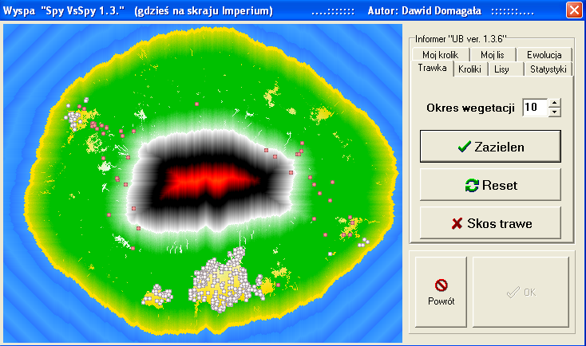
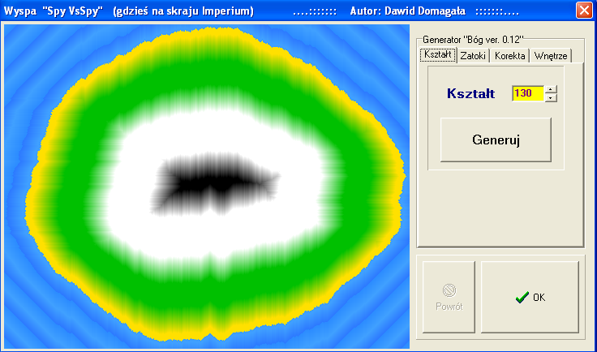
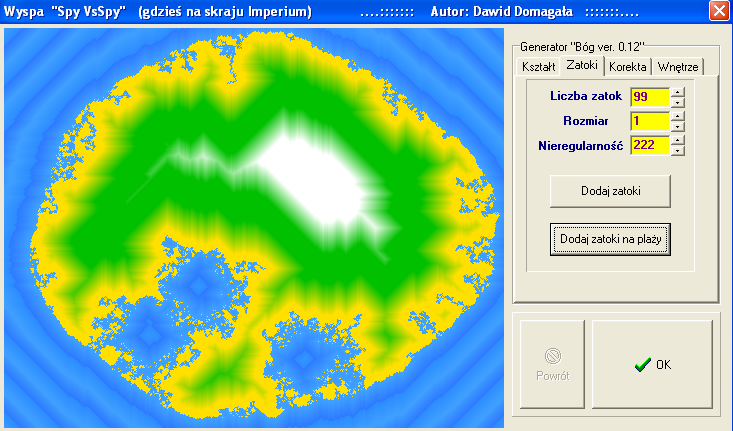
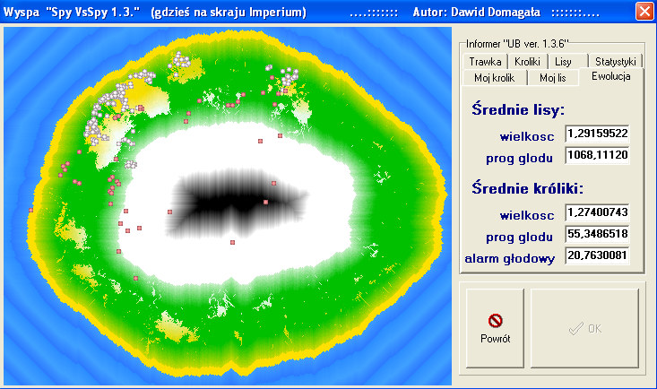

# 🇦🇺 Australia 1859 Sim (Wyspa) — Predator-Prey Island Ecosystem Life Simulator

[](https://en.wikipedia.org/wiki/C%2B%2B)
[](https://en.wikipedia.org/wiki/C%2B%2BBuilder)
[-lightgrey.svg)](https://microsoft.com/windows)
[-orange.svg)](https://github.com/DavIT-Futures)

[**English Overview**](#-english-overview) | [**Polska Dokumentacja**](#-polska-dokumentacja)

---

## 🌍 English Overview

### 🌿 What is This Simulation?
**Island** (*Wyspa*) is an artificial life (ALife) ecosystem simulator and cellular automata environment originally built in **January 2005** by Dawid Domagała for the Object-Oriented Programming course at Wrocław University of Science and Technology (*Politechnika Wrocławska*, Faculty of Electronics).

The project simulates a self-sustaining, emergent ecosystem on an isolated island:
1. **Procedural Island Synthesis:** The user first crafts the island geography. The land is encircled by sparkling blue ocean water with animated wave patterns, soft golden sandy beaches along the coast, expansive green grass meadows inland, rocky mountain ridges, snow-capped peaks, and impassable volcanic zones.
2. **Dynamic Grass Vegetation:** Green grass sprouts and regrows across the island terrain over time based on configurable vegetation velocity parameters.
3. **Prey (Rabbits):** Herbivorous rabbits roam the grassy plains. Every step consumes metabolic energy (measured in Joules). When hungry, rabbits search for grass to graze on. As they feed and age, they reach sexual maturity, undergo gestation, and give birth to offspring.
4. **Predators (Foxes):** Carnivorous foxes are introduced to the island. Foxes hunt rabbits for food, manage their own metabolic burn, form packs, and reproduce when well-fed.
5. **The Closed Ecological Cycle:** *Grass grows &rarr; Rabbits graze on grass &rarr; Foxes hunt rabbits &rarr; Overhunting causes foxes to starve &rarr; Vegetation recovers &rarr; The cycle continues endlessly in a dynamic Lotka-Volterra equilibrium.*

---

### 🇦🇺 The Historical Connection: The Australian Rabbit Crisis of 1859
This simulation closely mirrors one of the most famous ecological events in history: **the Australian rabbit plague**.

> In October 1859, 24 European wild rabbits were released in Victoria, Australia by Thomas Austin for recreational hunting. With virtually no native natural predators and a vast continent of lush flora, the rabbit population exploded exponentially into hundreds of millions. They devastated farmland, triggered catastrophic soil erosion, and decimated indigenous vegetation.
> 
> To curb the invasion, **red foxes** were introduced to Australia in 1871. However, instead of simply containing the rabbits, foxes established their own predatory pressure and severely threatened native wildlife—creating a classic real-world demonstration of **predator-prey-vegetation dynamics, invasive species pressure, and ecological carrying capacity**, exactly as modeled in this simulator.

---

### 🎮 Key Gameplay & Simulation Mechanics
* **Island Generator:**
  * Procedural contour synthesis combining geometric bounding boxes with 4 sinusoidal wave functions of customizable amplitude and random noise.
  * Diamond-algorithm coastal bay generator for carving natural fjords and coves into the coastline.
  * Cellular automata smoothing filters (alternating morphological dilation and erosion using cross-shaped masks).
  * Color gradient terrain zones with noise grain: *Salt Water &rarr; Sand Beach &rarr; Grassland &rarr; Snow &rarr; Mountains & Volcano*.
* **Animal Behavioral AI & Genetics:**
  * Real-time priority hierarchy (eating, fleeing predators, mating).
  * Individual metabolism (Joules per action), hunger threshold, gestation duration, eyesight radius, and lifespan.
  * Behavioral customization and easter eggs (including *"Neo the Commando Rabbit"*).
* **Live Statistics Dashboard:**
  * Real-time counters of active rabbit and fox populations.
  * Detailed mortality analytics: deaths from old age, starvation, or predation.
* **Plug & Play Retro Binaries (Dedicated Branches):**
  * The historical Borland VCL Win32 executables (`wyspa.exe`) from 2005 are preserved in dedicated Git branches: [`ver16`](https://github.com/DavIT-Futures/Australia-1859-Sim/tree/ver16), [`ver15`](https://github.com/DavIT-Futures/Australia-1859-Sim/tree/ver15), and [`ver14`](https://github.com/DavIT-Futures/Australia-1859-Sim/tree/ver14).
  * Run natively on **Windows 10 & Windows 11 64-bit** with zero installation or external DLL dependencies.

---

## 📸 Screenshots & Gallery

| Island Ecosystem View | Island Shape Generator |
|:---:|:---:|
|  |  |

| Coastal Bays & Coves Generator | Live Population Statistics |
|:---:|:---:|
|  |  |

---

## 🇵🇱 Polska Dokumentacja

### 🌟 Opis Projektu
Projekt symulacji ekosystemu wyspy (drapieżnik–ofiara) zrealizowany w **styczniu 2005 roku** w ramach kursu **Projekt z Programowania Obiektowego** na **Wydziale Elektroniki Politechniki Wrocławskiej**.

Aplikacja modeluje interakcje w zamkniętym ekosystemie wyspy pomiędzy **roślinożercami (króliki)**, **drapieżnikami (lisy)** a **zasobami środowiskowymi (wegetacja trawy)** na dynamicznie generowanym, konfigurowalnym terenie.

### Główne Funkcjonalności
* **Generator wyspy:**
  * Rysowanie konturu wyspy oparte o 4 sinusojdy i szum losowy,
  * Generator nieregularnych zatok (od małych zatoczek po głębokie fiordy),
  * Wygładzanie brzegów oparte o automaty komórkowe z maską krzyżową (naprzemienne operacje dylatacji i erozji lądu i wody),
  * Strefy gradientowe: morze, plaża, trawa, śnieg, góry, wulkan.
* **Symulacja Życia i Ekologii:**
  * **Króliki (Ofiary):** spalanie dżuli przy ruchu, głód, poszukiwanie trawy, ucieczka przed lisem, dojrzałość, ciąża, śmierć głodowa/ze starości/ze zjedzenia.
  * **Lisy (Drapieżniki):** polowanie na króliki, pościg, zapotrzebowanie energetyczne, watahy i rozród.
  * **Wegetacja Trawy:** dynamiczny wzrost trawy, odnawianie się wyjedzonych kęp.
  * **Inżynieria Genetyczna:** panel edycji cech osobniczych i priorytetów zachowań ("Neo jako królik-komandos").
  * **Statystyki:** liczniki populacji i przyczyn zgonów na żywo.

---

## 📁 Struktura Repozytorium

```
Australia-1859-Sim/
├── modern/                # ✨ NOWOCZESNY PORT C++20 + RAYLIB (Visual Studio 2026 / CMake)
│   ├── CMakeLists.txt     # Automatyczne pobieranie Raylib i konfiguracja projektu
│   ├── src/               # Przeniesiony, w 100% wierny kod algorytmiczny
│   │   ├── main.cpp       # Nowoczesne okno 60 FPS, pętla gry i interfejs HUD
│   │   ├── Simulation.cpp # Generator wyspy, BFS fal, wegetacja, renderer RGBA
│   │   ├── Kroliki.cpp    # Klasa królików, stado, metabolizm, rozród, ucieczka
│   │   ├── Lisy.cpp       # Klasa lisów, polowanie, stado, zachowanie
│   │   ├── ClassicUI.cpp  # Retro interfejs Win95/Borland (kontrolki, edytowalne pola, zakładki)
│   │   └── *.h            # Klasy bazowe, deklaracje i nagłówki
│   ├── assets/            # Oryginalne ikony, sprite'y zwierząt i czcionka Tahoma
│   └── bin/               # Gotowy, skompilowany plik Australia1859Sim.exe (x64)
├── docs/                  # Dokumentacja i materiały archiwalne
│   ├── wyspa.doc          # Oryginalna dokumentacja projektowa PWr (2005)
│   └── screenshots/       # Zrzuty ekranu w formacie PNG
├── plany.txt              # Oryginalne notatki autora z prac nad projektem
├── .gitignore             # Wykluczenie plików tymczasowych Borland i CMake
└── README.md              # Niniejsza dokumentacja
```

> **Wersje archiwalne z 2005 roku:** Wersje `ver14`, `ver15` oraz `ver16` (Borland C++Builder 6) są zachowane w osobnych gałęziach Git (`git checkout ver14`, `ver15`, `ver16`). Więcej szczegółów w sekcji [Wersje Klasyczne](#-wersje-klasyczne-2005-archiwalne-gałęzie-git).

---

## ⚡ Modern C++20 Port (Raylib + Authentic Borland UI / English Interface)

The project includes a modern, high-performance port in `modern/` running at 60 FPS, maintaining **100% of the original 2005 Lotka-Volterra & cellular automata algorithms**, fully translated into **English** with an improved **2-Phase Workflow**:

### 🏝️ Streamlined 2-Phase Gameplay Flow:
1. **Phase 1: Island Generator (`Island Generator ver. 1.4`):**
   * Shape your procedural island before introducing life:
     * **`Shape`** – Select sinusoidal wave amplitude (`130`) and click `Generate Island`.
     * **`Bays`** – Adjust bay count, size, and irregularity; click `Carve Deep Bays` or `Carve Coastal Bays`.
     * **`Adjust`** – Expand (`+`) or shrink (`-`) landmass, smooth coastline with cellular automata.
     * **`Terrain`** – Configure beach, grass, snow altitudes, and inject noise grain.
   * Click **`Start Simulation >>`** to finalize the island and bring the world to life!

2. **Phase 2: Ecosystem Simulation & Control (`Ecosystem Manager ver. 1.4`):**
   * The entire living world is active with full live control:
     * **`Grass`** – Adjust vegetation rate, lush grass (max), mow grass (min), or reset terrain.
     * **`Rabbits`** – **Direct Spawner (`+ Spawn Rabbits Now`)** + Live Genetic / Metabolic controls (speed, metabolism, grass bite, stomach, hunger, starving threshold, fox detection, lifespan).
     * **`Foxes`** – **Direct Spawner (`+ Spawn Foxes Now`)** + Live Predator traits (speed, metabolism, rabbit nutritive value, stomach, hunger, lifespan, maturity, gestation).
     * **`Stats`** – Live counters of alive rabbits/foxes, deaths by starvation, age, or predation.
     * **`My Rabbit`** – Real-time tracker for individual rabbits: status (mating, hungry, fleeing, starving), gender, age, stomach fullness, gestation, size + individual actions (`Feed Rabbit`, `Remove Selected`).
     * **`My Fox`** – Real-time tracker for individual foxes: status (mating, hunting, prowling), gender, age, stomach fullness, gestation, size + individual actions (`Feed Fox`, `Remove Selected`).
     * **`Evolution`** – Dynamic real-time population averages.
   * **Clicking any animal on the 500x400 map** instantly locks onto it with the target marker (`wybrany.bmp`) and opens its card in `My Rabbit` or `My Fox`!
   * Click **`<< Island`** at any time to return to island generation and re-sculpt the land.

### 🖥️ 1.7x Upscaled Screen (1280x748), Tahoma Bold Typography & Borland UI:
* **1.7x High-DPI Upscale:** Default window expanded 1.7x to **1280x748** with an **850x680 island map** for expansive modern display clarity.
* **Tahoma Bold TrueType Typography:** High-legibility **Tahoma Bold** (`tahomabd.ttf`) rendered with subpixel alpha blending for crystal-clear readability on all controls, textboxes, and labels.
* **Authentic Win95/Win2000 Aesthetics:** 3D sunken/raised borders, etched GroupBoxes, yellow TEdit fields, TUpDown numeric spinbox arrows (`^`/`v`), MultiLine tabs.
* **Full Island Colonization & Uncapped Ecology:**
  * Fixed historical 2005 vector inversion in grass memory (`pamiec_trawy`) that previously repelled rabbits into map corners.
  * Added wide-perimeter grass foraging (up to radius 20) and wandering inertia so rabbits explore and populate the entire island.
  * Localized mate detection to natural sensory ranges (preventing whole-island gravitational clumping into one corner).
  * Raised artificial 1990s population cap from 999 to 6,000 — population is now naturally regulated by grass carrying capacity and starvation.
* **📊 Bottom Live Telemetry & Stats Bar:** Real-time metrics rendered in sunken Win95 status panels:
  * **Rabbits alive:** Instantaneous population count.
  * **Foxes alive:** Instantaneous predator count.
  * **Grass Coverage:** Exact biomass percentage across the island (`Grass: XX.X%`).
  * **Simulation Tick:** Current evolutionary step counter.
* **⏱️ Interactive Speed Controller:** Slow down or accelerate the simulation anytime:
  * Fine-grained `[-]` and `[+]` stepping buttons.
  * 1-click speed presets: **`0.5x`** (slow-motion observation), **`1x`** (normal), **`2x`**, **`5x`**, **`10x`** (fast-forward evolution).
* **🖥️ Fullscreen (F11):** Toggle between windowed and fullscreen with the button or **`F11`** hotkey. Uses letterboxed virtual resolution so graphics and mouse coordinates remain pixel-perfect on any screen resolution.

### 🎮 How to Run (Prebuilt Executable):
A standalone, fully statically linked 64-bit Windows executable is ready in:  
👉 **`modern/bin/Australia1859Sim.exe`**  
Just double-click to run on Windows 10 & 11 with zero dependencies!

### ⌨️ Controls & Hotkeys:
* **`[F11]`** / **Panel Button** – Fullscreen toggle (Letterbox 4:3 / 16:9)
* **`[SPACE]`** – Start simulation (Phase 1) / Pause or Resume (Phase 2)
* **`[-]` / `[+]` / Bottom Bar Buttons** – Adjust simulation speed (`0.25x` to `10.0x`)
* **`[1] / [2] / [3] / [4] / [5]`** – Speed presets (`0.5x`, `1x`, `2x`, `5x`, `10x`)
* **`Mouse Click on Island Map`** – Select and lock onto the closest rabbit or fox (`My Rabbit` / `My Fox`)
* **`Clicking Tabs and UpDown Spinners`** – Adjust parameters, spawn animals, and manage genetics in real time!

### 🛠️ Kompilacja portu ze źródeł (Visual Studio 2026 / CMake):
```bash
cd modern
cmake -B build
cmake --build build --config Release
```
CMake automatycznie pobierze i skompiluje bibliotekę Raylib – nie trzeba nic instalować ręcznie!

---

## 🏛️ Wersje Klasyczne 2005 (Archiwalne Gałęzie Git)

Oryginalne, archiwalne wersje ze środowiska **Borland C++Builder 6** zostały wyodrębnione do dedykowanych gałęzi Git z plikami umieszczonymi bezpośrednio w katalogu głównym:

* **[`ver16`](https://github.com/DavIT-Futures/Australia-1859-Sim/tree/ver16)** – Ostateczna wersja projektu z 2005 roku (`wyspa.exe`, pełny kod źródłowy i formularze VCL).
* **[`ver15`](https://github.com/DavIT-Futures/Australia-1859-Sim/tree/ver15)** – Wersja pośrednia z implementacją płodów i watah.
* **[`ver14`](https://github.com/DavIT-Futures/Australia-1859-Sim/tree/ver14)** – Wczesna wersja prototypowa.

Aby pobrać i uruchomić wybraną wersję archiwalną:
```bash
git checkout ver16   # Przełączenie na gałąź z wersją 1.6
git checkout ver15   # Przełączenie na gałąź z wersją 1.5
git checkout ver14   # Przełączenie na gałąź z wersją 1.4
```
Plik wykonywalny `wyspa.exe` z tych gałęzi działa natywnie na współczesnych systemach Windows (Windows 10, Windows 11 64-bit) pod warstwą WOW64. Do rekompilacji źródeł z gałęzi archiwalnych wymagane jest środowisko **Borland C++Builder 6.0** (lub Embarcadero C++Builder z obsługą VCL).

---

## 👨‍💻 Autor / Author

* **Dawid Domagała** ([@DavIT-Futures](https://github.com/DavIT-Futures))
* Politechnika Wrocławska, Wydział Elektroniki (2005)
